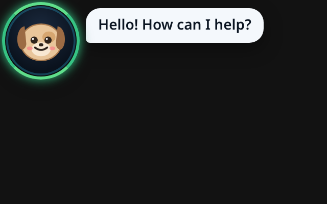

<div align="center">


# J.A.R.V.I.S. Mobile

### *“At your service.”* — a floating, voice-controlled assistant for your phone

A little robot lives in a circle on your screen **over every app**.
Tap it or say **“Jarvis…”** and it **does the work**: calls, alarms, music, navigation,
flashlight, settings, and controlling the screen like Voice Access.
Everyday commands run **instantly on the phone**; everything else goes to the AI you choose:
**Gemini, OpenAI, Claude, Grok, Groq, OpenRouter, DeepSeek, Mistral** or your own **OpenJarvis**.




<sub>The ring shows what it's doing: <b>blue</b> listening · <b>amber</b> thinking · <b>green</b> speaking</sub>

<br><br>

&nbsp;&nbsp;&nbsp;

</div>

---

## ✨ Highlights

| | |
|---|---|
| 🫧 **Floating bubble** | A small circle that stays on screen over every app (Android), like a chat head. Drag it anywhere; it snaps to the edge. Drop it on the ✕ to close it |
| ⚡ **Instant commands** | “Open YouTube”, “call Mom”, “alarm for 6:30”, “volume up”, “flashlight on” run on the phone in a split second, with **no AI call** and no quota used. Only what it can't understand goes to the AI |
| 🗣️ **Your own commands** | Teach Jarvis a phrase (“good night”) and the steps to run, written in plain words |
| 📱 **Screen control** | Voice-Access style: “go back”, “scroll down”, “tap Send”, “type …”, “read the screen”. The AI can read the screen to answer questions about it |
| 🧠 **Any AI you like** | 10 providers, all keys in one list. If one is busy or out of quota, Jarvis can switch to another you have a key for |
| 🛠️ **33 real actions** | A function-calling agent that chains steps by itself (*find contact → call*) |
| 🎙️ **Touch or call** | Tap it to talk, or turn on the wake word and just say **“Jarvis, …”** |
| 🌙 **Runs in the background** | Foreground service with a mic, so it keeps listening while you use other apps. Optional start on boot |
| 🔄 **Updates itself** | Settings → About → **Update now** downloads the newest build from GitHub |
| 🤖 **A living companion** | An animated robot. It blinks, its eyes follow your finger, it yawns and naps, and it reacts when you pet, poke, tickle or fling it |
| 🔐 **Private** | Keys stay on your phone (or your own PC server). Notes, memory and your commands stay on the device |

## 👆 Touch the bubble

| Gesture | What happens |
|---|---|
| **Tap** | Jarvis listens. Tap again to stop it talking |
| **Say “Jarvis …”** | Hands-free (turn on *Wake word*) |
| **Double-tap** | Opens the full Jarvis app (chat, settings) |
| **Hold** | Pet it 💕 |
| **Drag** | Move it. It snaps to the nearest edge |
| **Drag onto ✕** | Close the bubble |
| **5 quick taps** | It gets dizzy |
| **Notification → Talk / Quick-settings tile** | Talk without finding the bubble |

## ⚡ How Jarvis decides what to do

```
 you say something
        │
        ├─▶ one of your own commands?  ──▶ run its steps            (instant)
        ├─▶ a built-in phone command?  ──▶ do it on the phone        (instant, no AI)
        └─▶ anything else              ──▶ ask the AI, which can use 33 actions
```

Anything handled on the phone shows an **instant** tag in the chat. Quiet actions (“go back”, “volume up”) just play a short chime.

### Built-in commands (no AI)

| | Say |
|---|---|
| 📱 **Apps & calls** | “Open YouTube” · “Call Mom” · “Call 98765 43210” |
| ⏰ **Clock** | “Set an alarm for 6:30 am” · “Wake me up at 7” · “Timer for 10 minutes” · “5 minute timer” |
| 🔦 **Phone** | “Flashlight on” · “Volume up” · “Set volume to 40” · “Mute” · “Battery level” · “What time is it” · “What's the date” · “Find my phone” · “Take a selfie” |
| ⚙️ **Settings panels** | “Turn on Bluetooth” · “Wi-Fi on” · “Open location settings” *(Android only lets apps open these panels, not flip the switch)* |
| 🎵 **Music** | “Pause” · “Resume” · “Next song” · “Play Believer on Spotify” |
| 🗺️ **Web & maps** | “Search for cricket score” · “Navigate to the airport” · “What's the weather” · “Will it rain tomorrow” |
| 📝 **Notes** | “Note buy milk” · “Read my notes” |
| 🖐️ **Screen** | “Go back” · “Go home” · “Recent apps” · “Show notifications” · “Quick settings” · “Scroll down” · “Tap Send” · “Type hello” · “Read the screen” · “Lock the phone” · “Take a screenshot” |

The AI handles questions, reminders, messages, several steps in one sentence (“open YouTube **and** play Believer”), calls where more than one contact matches, and other languages. You can switch instant commands off in **Settings → Commands**.

### Your own commands

**Settings → Commands → Your commands → Add command**, or start from an example (*Good night*, *Good morning*, *I'm driving*, *Movie time*):

| Field | Example |
|---|---|
| **When I say** (commas between options) | `good night, going to sleep` |
| **Do this** (one step per line, plain words) | `turn off the flashlight`<br>`set an alarm for 6:30 am`<br>`mute` |
| **Then say** (optional) | `Good night! Alarm set for 6:30.` |

Steps can be any built-in command, `say …` to speak, or `wait 2 seconds`. A step Jarvis can't do by itself is handed to the AI. Tap **Try it** to test.

### 📱 Screen control (like Voice Access)

Lets Jarvis go back, go home, scroll, tap buttons by their name, type, and read the screen. The AI can also read the screen when you ask about it: *“what does this message say?”*, *“summarise this page”*. Jarvis only reads the screen when you ask.

1. **Settings → Commands → Turn on “Jarvis screen control”** and switch it on in Android's Accessibility settings.
2. **Android 13+:** if it says **Restricted setting**, tap **Open app info**, then **⋮** (top right) → **Allow restricted settings**, and turn it on again. This is normal for apps installed outside the Play Store.
3. Use it from the floating bubble while you're in another app; commands act on whatever is on screen.

## 🗣️ What the AI can do

Just say it naturally. The AI decides which of its 33 actions to use.

| Category | Things you can say | Android app | Browser |
|---|---|:-:|:-:|
| 📞 **Calls** | “Call Mom” · “Call 98765 43210” | ✅ direct call | dialer |
| 👥 **Contacts** | “What's Rahul's number?” | ✅ phone contacts | saved list |
| 💬 **Messages** | “Text Priya I'm on my way” · “WhatsApp Dad good night” · “Email boss I'm sick today” | ✅ pre-filled | ✅ |
| 📱 **Open apps** | “Open Instagram” · “Open my banking app” | ✅ *any* installed app | popular ones |
| 🎵 **Music & video** | “Play Believer on Spotify” · “Pause” · “Next song” | ✅ + playback control | ✅ play |
| 🔊 **Volume** | “Volume to 30%” · “Mute ringtone” | ✅ | — |
| ⏰ **Alarms & timers** | “Wake me up at 6:30 on weekdays” · “10-minute timer” | ✅ clock app | in-app timer |
| 🔔 **Reminders** | “Remind me at 6 pm to buy milk” · “What are my reminders?” | ✅ notification | while open |
| 📅 **Calendar** | “Add a meeting tomorrow at 3 pm” | ✅ | ✅ |
| 🗺️ **Navigation** | “Navigate to the airport” · “Walk to the nearest ATM” | ✅ | ✅ |
| 🌦️ **Weather** | “Will it rain tomorrow?” · “Weather in Chennai” | ✅ | ✅ |
| 📍 **Location** | “Where am I?” | ✅ | ✅ |
| 👀 **Read the screen** | “What does this message say?” · “Summarise this page” | ✅ | — |
| 🖐️ **Control the screen** | “Scroll down and tap Reply” | ✅ | — |
| 🔦 **Flashlight** | “Turn on the torch” | ✅ | Chrome only |
| ⚙️ **Settings** | “Open Wi-Fi” · “Bluetooth settings” · “Do not disturb” | ✅ | — |
| 📷 **Camera** | “Open the camera” · “Record a video” | ✅ | — |
| 🔋 **Phone status** | “How much battery?” · “Am I on Wi-Fi?” | ✅ | partly |
| 📳 **Find my phone** | “Vibrate” | ✅ | ✅ |
| 🔎 **Search** | “Search the latest iPhone price” · “Show me pictures of Goa” | ✅ | ✅ |
| 📝 **Notes & to-dos** | “Note: buy a charger” · “Read my notes” | ✅ | ✅ |
| 🧠 **Memory** | “Remember my sister's birthday is 12 March” | ✅ | ✅ |
| 📋 **Clipboard & share** | “Copy that” · “Share this with…” | ✅ | ✅ |
| 💡 **Questions & chat** | Facts, maths, translation, writing, advice… | ✅ | ✅ |
| 🖥️ **PC tasks** | “Ask OpenJarvis to summarise my emails” | ✅ | ✅ |

> 🔒 Messages and emails open **pre-filled**, so you press send and nothing goes out without you. Calls go straight through only once you grant the *Phone* permission.

## 🧠 AI providers

Add keys in **Settings → Brain → API keys** (each has a **Get key ↗** link). A green dot on a provider means its key is saved. Leave the model blank and Jarvis picks a fast one, or tap **Load** to choose.

| Provider | Cost | Get a key | Good for |
|---|---|---|---|
| **Gemini** | Free tier | [aistudio.google.com/apikey](https://aistudio.google.com/apikey) | Default; good all-rounder |
| **Groq** | Free tier | [console.groq.com/keys](https://console.groq.com/keys) | **Fastest replies** |
| **Mistral** | Free tier | [console.mistral.ai](https://console.mistral.ai/api-keys) | |
| **OpenRouter** | Some free models | [openrouter.ai/keys](https://openrouter.ai/keys) | One key, hundreds of models |
| **OpenAI** | Paid | [platform.openai.com](https://platform.openai.com/api-keys) | |
| **Claude** | Paid | [console.anthropic.com](https://console.anthropic.com/settings/keys) | |
| **Grok** | Paid | [console.x.ai](https://console.x.ai) | |
| **DeepSeek** | Paid, cheap | [platform.deepseek.com](https://platform.deepseek.com/api_keys) | |
| **Custom** | — | — | Any OpenAI-compatible server (LM Studio, Ollama, vLLM…) |
| **OpenJarvis** | Free | your PC | Runs on your own computer |

Jarvis copes with flaky providers by itself:

- **Busy (503) or out of quota (429):** it retries, then tries the newest Gemini Flash models your key can use, and remembers whichever works.
- **Use another provider if this one fails** (on by default): answers with another provider you have a key for, and shows *“answered by …”* in the chat.
- **Pasted keys are cleaned** (spaces, line breaks, quotes, `Bearer `), and the key list shows what's saved (`xai-A…6789 · 84 characters`) with a warning if it looks like the wrong provider's key.
- When something fails, Jarvis **says why**: bad key, no credits, daily limit used, overloaded, or no internet.
- **Test connection** shows the reply time and model, e.g. `✓ 1.2 s · gemini-…-flash`.

## ⚙️ Settings

Tabs: **General · Brain · Voice · Commands · Phone · About**. **Swipe left or right** to move between them; the **back** arrow or Android's back gesture returns to Jarvis. Tap **ⓘ** on any card for an explanation.

| Tab | What's there |
|---|---|
| **General** | Your name, contacts, music app, memory |
| **Brain** | AI provider, model, fallback, test connection, all API keys |
| **Voice** | Wake word, language, voice, speed, robot beeps |
| **Commands** | Your commands, the instant-command list, screen control |
| **Phone** | Permissions, background running, floating bubble, start on boot |
| **About** | Updates and app info |

## 📲 Install on Android (recommended)

1. Download **`Jarvis.apk`** from the [latest release](../../releases/tag/latest) on your phone. GitHub Actions builds it on every push.
2. Open it and allow **Install unknown apps**.
3. In Jarvis, open **⚙ Settings**:
   - **Brain → API keys:** add at least one key (Gemini, Groq and Mistral are free)
   - **Phone → Grant permissions** (microphone, contacts, phone, location, notifications, display over other apps)
   - **Phone → Allow running in background** (so Android doesn't kill it)
   - **Start bubble** 🫧 (the blue button at the top of the home screen, or Settings → Phone)
4. **Hands-free:** turn on **Listen for “Jarvis”** (Settings → Phone, or *Wake word* on the home screen), then just say *“Jarvis, …”*, no tap needed. Turn on **Voice → Keep the conversation going** to ask follow-ups without saying “Jarvis” again.
5. *(Optional)* **Commands → Screen control**, **Start on boot**, and the **“Talk to Jarvis”** quick-settings tile.

**Updating:** Settings → About → **Check for updates → Update now**. Jarvis downloads the new build, Android asks you to confirm, and your settings, keys and memory are kept. A dot on ⚙ tells you when an update is ready. *(Builds made before in-app updates existed need one manual install from the release page.)*

<details>
<summary><b>Build the APK yourself</b></summary>

You need JDK 17+, the Android SDK (platform 35) and Gradle 8.10+:

```bash
cd android
gradle assembleRelease
# → app/build/outputs/apk/release/app-release.apk
```

Or open the `android/` folder in Android Studio and press ▶. The web app in `web/` is bundled straight into the APK, so there's one codebase for both.

</details>

## 🌐 Or use it in the browser (any phone, including iPhone)

```bash
cp .env.example .env          # add GEMINI_API_KEY / XAI_API_KEY (+ JARVIS_TOKEN)
python3 server.py --https     # Python 3.9+, no dependencies
```

Open the printed **Phone** URL (same Wi-Fi), accept the certificate warning, then use **Add to Home screen**. Keys for the other providers can be added in Settings; those requests go straight from the phone. **Settings → About → Reload latest** fetches new files.

> Browsers can't draw over other apps, listen in the background, or control the screen. For that, use the Android app.

## 🧩 OpenJarvis on your PC

[OpenJarvis](https://github.com/open-jarvis/OpenJarvis) (Stanford) is a local-first framework for personal AI agents. Jarvis Mobile can use it as its brain, or hand heavy jobs to it:

```bash
curl -fsSL https://open-jarvis.github.io/OpenJarvis/install.sh | bash
jarvis serve --port 8000
echo "OPENJARVIS_URL=http://127.0.0.1:8000" >> .env && python3 server.py --https
```

In the app, either choose **Brain → OpenJarvis**, or keep another provider and say *“ask OpenJarvis to …”*. On Android, set **Jarvis server URL** (Brain → Connection) to your PC's address (Tailscale works great).

## 🏗️ How it works

```
┌──────────────── Android app ─────────────────┐
│  BubbleService (foreground, mic)             │
│   └─ overlay window ─ WebView  ┐             │         ┌─ Gemini · OpenAI · Claude
│  MainActivity ─ WebView ───────┤ same web/   │  HTTPS  ├─ Grok · Groq · OpenRouter
│                                │ code        ├────────▶├─ DeepSeek · Mistral · custom
│  JarvisBridge (window.JarvisNative):         │         ├─ OpenJarvis (your PC)
│   speech · TTS · HTTP · calls · contacts ·   │         ├─ Open-Meteo weather
│   apps · alarms · torch · media · volume ·   │         └─ GitHub Releases (updates)
│   settings · reminders · updates             │
│  ScreenService (accessibility): back, home,  │
│   scroll, tap, type, read the screen         │
└──────────────────────────────────────────────┘
```

| Path | Purpose |
|---|---|
| `web/app.js` | Voice state machine, command routing, agent loop, settings UI |
| `web/commands.js` | Instant on-phone commands and your saved commands |
| `web/llm.js` | All AI providers (Gemini, Claude, OpenAI-compatible), retries and fallback |
| `web/tools.js` | The 33 actions, with native versions when running in the app |
| `web/update.js` | In-app update check and install |
| `web/buddy.js`, `buddy.css` | The animated robot companion |
| `web/native.js` | Bridge to Android (speech, HTTP, device controls) |
| `android/…/BubbleService.kt` | Floating overlay, drag and snap, ✕ to close, foreground service |
| `android/…/JarvisBridge.kt` | Native phone abilities exposed to the web code |
| `android/…/ScreenService.kt` | Voice-Access-style screen control (accessibility service) |
| `android/…/Updater.kt` | Downloads a new APK and opens Android's installer |
| `android/…/Voice.kt` | Android SpeechRecognizer and TextToSpeech |
| `server.py` | Optional PC server: HTTPS, API-key proxy, OpenJarvis relay |

## ⚠️ Good to know

- **iPhone:** iOS doesn't let apps float over other apps or listen in the background, so use the web version there.
- **Instant commands understand English.** Other languages still work; they go to the AI.
- **Wake word** uses Android's speech service in a loop. It works well but uses more battery than tap-to-talk. Some phones (Xiaomi, Oppo, Vivo, Samsung) also need *Autostart* or *No restrictions* for Jarvis in battery settings.
- Android 14+ won't allow the microphone at boot, so after a restart the bubble comes back but you need to tap it once before the wake word works.
- Android only lets apps **open** the Wi-Fi, Bluetooth and mobile-data panels, not switch them; with screen control on you can then say “tap Bluetooth”.
- The APK is signed with a public sideload key, so updates install over each other. If you publish to the Play Store, use your own key.

## 🔒 Privacy

- Voice is transcribed by your phone's speech service.
- Instant and saved commands never leave the phone (except web searches, maps and weather, which open those services).
- AI requests go only to the provider you choose (or the fallback provider you have a key for).
- Screen text is read only when you ask, and is sent to the AI only when you ask the AI about it.
- Keys, notes, memory, reminders and your commands stay on the device.

---

<div align="center">
Built with ❤️ · Inspired by Tony Stark's J.A.R.V.I.S. · Powered by the AI of your choice & OpenJarvis
</div>
