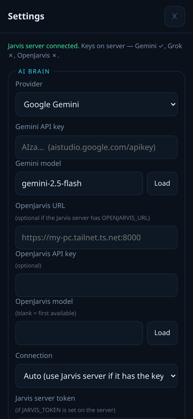

<div align="center">


# J.A.R.V.I.S. Mobile

### *“At your service.”* — a voice-controlled AI assistant for your phone

Talk to it. It listens, thinks with **Gemini** or **Grok**, and **does the work**: calls, messages, music, navigation, reminders, weather, notes, flashlight and more.


&nbsp;&nbsp;&nbsp;

</div>

---

## ✨ Features

| | |
|---|---|
| 🎙️ **Hands-free voice** | Tap the arc-reactor orb, or turn on the **“Jarvis…”** wake word for hands-free use |
| 🗣️ **Talks back** | Spoken replies in your chosen voice, language and speed, with follow-up listening when Jarvis asks a question |
| 🧠 **Pick your brain** | Google **Gemini**, xAI **Grok**, or your own **OpenJarvis** agent. Switch any time |
| 🛠️ **26 real actions** | Function-calling agent loop. Jarvis chains tools by itself (e.g. *find contact → call*) |
| 🔐 **Keys stay safe** | Keep API keys on your PC behind the included proxy server, with an optional access token |
| 📲 **Installable** | Add it to your home screen like a native app. Offline shell, notifications, “Talk to Jarvis” shortcut |
| 💾 **Remembers you** | Long-term memory, notes and reminders stored on your device |

## 🗣️ Things you can say

> “Jarvis, **call Mom**” · “**Text Rahul** I'm running 10 minutes late” · “**WhatsApp** 9198xxxxxxx good morning”
> “**Play** Believer on Spotify” · “**Navigate** to the airport” · “What's the **weather** tomorrow?”
> “**Remind me** at 6 pm to buy milk” · “Set a **timer** for 10 minutes” · “Add a **meeting** tomorrow at 3”
> “Turn on the **flashlight**” · “What's my **battery**?” · “**Open** Instagram” · “**Search** latest iPhone price”
> “**Remember** that my sister's birthday is 12 March” · “**Take a note**: buy a charger”
> “**Ask OpenJarvis** to summarise my unread emails” *(runs on your computer)*

<details>
<summary><b>Full tool list</b></summary>

| Tool | What it does |
|---|---|
| `get_datetime` | Current local date/time |
| `open_website`, `web_search` | Open sites; Google / images / news / YouTube search |
| `open_app` | YouTube, WhatsApp, Instagram, Spotify, Gmail, Maps, Camera, Settings, Wi-Fi, … |
| `find_contact` | Looks up numbers from the contacts you save in settings |
| `make_call`, `send_sms`, `send_whatsapp`, `send_email` | Pre-filled dialer / SMS / WhatsApp / mail |
| `navigate` | Google Maps directions (drive, walk, cycle, transit) |
| `play_media` | YouTube, YouTube Music, Spotify |
| `get_weather`, `get_location` | Open-Meteo weather + 3-day forecast, GPS + address |
| `set_timer`, `list_or_cancel_timers` | Countdown timers with sound, vibration and notification |
| `set_reminder`, `list_reminders`, `add_calendar_event` | In-app reminders + Google Calendar events |
| `notes`, `remember` | Notes and to-dos, plus long-term memory about you |
| `device_status`, `flashlight`, `vibrate` | Battery and network status, torch, “find my phone” buzz |
| `copy_to_clipboard`, `share_text` | Clipboard and the share sheet |
| `ask_openjarvis` | Delegates a task to the OpenJarvis agent on your PC |

</details>

## 🚀 Quick start

### Option A: run the server on your PC (recommended)

```bash
git clone git@github.com:Gokul02k/Jarvis_mobile.git && cd Jarvis_mobile
cp .env.example .env          # add GEMINI_API_KEY and/or XAI_API_KEY (+ JARVIS_TOKEN)
python3 server.py --https     # Python 3.9+, no dependencies
```

1. On your phone (same Wi-Fi), open the **Phone** URL it prints, e.g. `https://192.168.1.20:8080`.
2. Accept the self-signed certificate warning (*Advanced → Proceed*).
3. Allow the microphone, then use **⋮ → Add to Home screen**.
4. If you set `JARVIS_TOKEN`, enter it in **Settings → Jarvis server token**.

> 💡 Phones only allow the microphone on **HTTPS**, which is why `--https` matters. For access from anywhere, put the server behind [Tailscale](https://tailscale.com) (`tailscale serve 8080`) or a Cloudflare Tunnel, which give you a real certificate.

### Option B: static hosting, with keys on the phone

The `web/` folder is plain HTML/JS with no build step. Host it on **GitHub Pages**, Netlify or Vercel, open it on your phone, and paste your Gemini or Grok key into **Settings**. Keys are stored only in that phone's browser.

### Get API keys

- **Gemini:** [aistudio.google.com/apikey](https://aistudio.google.com/apikey) (has a free tier)
- **Grok:** [console.x.ai](https://console.x.ai)

Tap **Load** next to the model field to pick from the models your key can use. If a model is retired, Jarvis switches to the newest available one automatically.

## 🧩 Using OpenJarvis as the brain

[OpenJarvis](https://github.com/open-jarvis/OpenJarvis) (Stanford) is a local-first framework for personal AI agents. It runs on your computer, and Jarvis Mobile becomes its voice on your phone.

```bash
curl -fsSL https://open-jarvis.github.io/OpenJarvis/install.sh | bash
jarvis serve --port 8000                       # OpenAI-compatible API
echo "OPENJARVIS_URL=http://127.0.0.1:8000" >> .env
python3 server.py --https
```

You can then either:
- choose **Provider → OpenJarvis** so it handles every request, or
- keep Gemini or Grok as the fast phone brain, which hands heavy, computer-side jobs to OpenJarvis through the **`ask_openjarvis`** tool.

## 🏗️ How it works

```
 ┌──────────── Phone (PWA) ────────────┐        ┌──────── Your PC (optional) ────────┐
 │ 🎙 Web Speech API  →  transcript    │        │  server.py                          │
 │        ↓                            │  HTTPS │   ├─ /api/gemini  → Google Gemini   │
 │ 🧠 Agent loop  ⇄  LLM (tools)  ─────┼───────▶│   ├─ /api/xai     → xAI Grok        │
 │        ↓                            │        │   └─ /api/openjarvis → jarvis serve │
 │ 🛠 Phone tools: tel:, sms:, maps,   │        │      (keys from .env, token-gated)  │
 │    YouTube, timers, torch, GPS …    │        └─────────────────────────────────────┘
 │        ↓                            │
 │ 🔊 Speech synthesis                 │
 └─────────────────────────────────────┘
```

| File | Purpose |
|---|---|
| `web/app.js` | UI, wake word and voice state machine, agent loop, speech output |
| `web/llm.js` | Gemini and OpenAI-compatible (Grok / OpenJarvis) adapters with function calling |
| `web/tools.js` | All phone actions |
| `web/sw.js`, `manifest.json` | Installable PWA, offline shell, notifications |
| `server.py` | Static server, HTTPS, and API proxy that keeps keys off the phone |

## ⚠️ Good to know

- **Best on Chrome for Android.** Safari on iPhone works too, but its wake-word listening is less reliable.
- A web app can't listen while the **screen is off or the app is in the background**. In wake-word mode Jarvis keeps the screen awake. Always-on, lock-screen listening would need a native app.
- Browsers only open apps right after a tap. When an automatic open gets blocked, Jarvis shows a card with an **Open** button.
- Calls, SMS and emails open **pre-filled**. You press send, so nothing goes out without you.
- Timers and in-app reminders fire while Jarvis is open. For guaranteed alerts, say *“…and add it to my calendar.”*

## 🔒 Privacy

- Voice is transcribed by your browser's speech service.
- Your request goes only to the AI provider you picked.
- Notes, memory and reminders stay in your phone's local storage.
- With the server, API keys never leave your PC.

---

<div align="center">
Built with ❤️ for the phone · Inspired by Tony Stark's J.A.R.V.I.S. · Powered by Gemini, Grok & OpenJarvis
</div>
