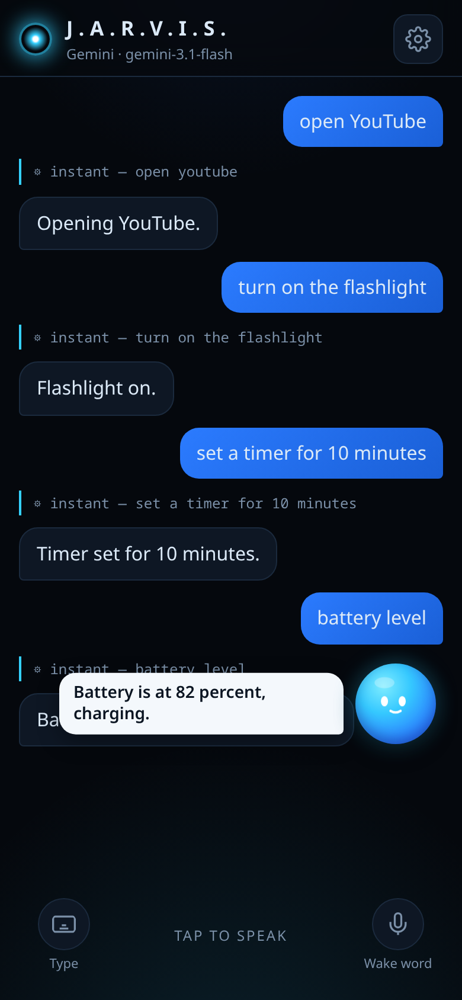

<div align="center">


# J.A.R.V.I.S. Mobile

### *“At your service.”* — a floating, voice-controlled AI buddy for your phone

A little animated companion lives in a circle on your screen **over every app**.
Tap it or say **“Jarvis…”**, tell it what you want, and it **does the work**:
calls, messages, music, alarms, navigation, reminders, flashlight, settings and more.
It thinks with **Gemini**, **Grok** or your own **OpenJarvis**.


<sub>The ring shows what it's doing: <b>blue</b> listening · <b>amber</b> thinking · <b>green</b> speaking</sub>

<br><br>

&nbsp;&nbsp;&nbsp;

</div>

---

## ✨ Highlights

| | |
|---|---|
| 🫧 **Floating bubble** | A small circle that stays on screen over every app (Android), like a chat head. Drag it anywhere and it snaps to the edge. Drop it on the ✕ to close it |
| 🤖 **A living companion** | An animated Jarvis robot. It blinks, its eyes follow your finger, it yawns and naps, and it reacts when you pet, poke, tickle or fling it |
| 🎙️ **Touch or call** | Tap it to talk, or turn on the wake word and just say **“Jarvis, …”** |
| 🌙 **Runs in the background** | Foreground service with a mic, so it keeps listening while you use other apps. Optional start on boot |
| 🧠 **Your choice of brain** | Google **Gemini**, xAI **Grok**, or **OpenJarvis** on your PC. Switch any time |
| 🛠️ **31 real actions** | A function-calling agent that chains steps by itself (*find contact → call*) |
| 🔐 **Private** | Keys stay on your phone or on your own PC server. Notes and memory stay on the device |

## 👆 Touch the bubble

| Gesture | What happens |
|---|---|
| **Tap** | Jarvis listens. Tap again to stop it talking |
| **Say “Jarvis …”** | Hands-free (turn on *Wake word*) |
| **Double-tap** | Opens the full Jarvis app (chat, settings) |
| **Hold** | Pet it 💕 (purrs, hearts) |
| **Drag** | Move it. It snaps to the nearest edge |
| **Drag onto ✕** | Close the bubble |
| **Tap its nose** | Achoo! 🤧 |
| **5 quick taps** | It gets dizzy |
| **Notification → Talk / Quick-settings tile** | Talk without finding the bubble |

## 🗣️ What can it do?

Just say it naturally. Jarvis decides which actions to use.

| Category | Things you can say | Android app | Browser |
|---|---|:-:|:-:|
| 📞 **Calls** | “Call Mom” · “Call 98765 43210” | ✅ direct call | dialer |
| 👥 **Contacts** | “What's Rahul's number?” | ✅ phone contacts | saved list |
| 💬 **Messages** | “Text Priya I'm on my way” · “WhatsApp Dad good night” · “Email boss I'm sick today” | ✅ pre-filled | ✅ |
| 📱 **Open apps** | “Open Instagram” · “Open my banking app” | ✅ *any* installed app | popular ones |
| 🎵 **Music & video** | “Play Believer on Spotify” · “Pause” · “Next song” | ✅ + playback control | ✅ play |
| 🔊 **Volume** | “Volume to 30%” · “Mute ringtone” | ✅ | — |
| ⏰ **Alarms & timers** | “Wake me up at 6:30 on weekdays” · “10-minute timer” | ✅ clock app | in-app timer |
| 🔔 **Reminders** | “Remind me at 6 pm to buy milk” · “What are my reminders?” | ✅ notification | while open |
| 📅 **Calendar** | “Add a meeting tomorrow at 3 pm” | ✅ | ✅ |
| 🗺️ **Navigation** | “Navigate to the airport” · “Walk to the nearest ATM” | ✅ | ✅ |
| 🌦️ **Weather** | “Will it rain tomorrow?” · “Weather in Chennai” | ✅ | ✅ |
| 📍 **Location** | “Where am I?” | ✅ | ✅ |
| 🔦 **Flashlight** | “Turn on the torch” | ✅ | Chrome only |
| ⚙️ **Settings** | “Open Wi-Fi” · “Bluetooth settings” · “Do not disturb” | ✅ | — |
| 📷 **Camera** | “Open the camera” · “Record a video” | ✅ | — |
| 🔋 **Phone status** | “How much battery?” · “Am I on Wi-Fi?” | ✅ | partly |
| 📳 **Find my phone** | “Vibrate” | ✅ | ✅ |
| 🔎 **Search** | “Search the latest iPhone price” · “Show me pictures of Goa” | ✅ | ✅ |
| 📝 **Notes & to-dos** | “Note: buy a charger” · “Read my notes” | ✅ | ✅ |
| 🧠 **Memory** | “Remember my sister's birthday is 12 March” | ✅ | ✅ |
| 📋 **Clipboard & share** | “Copy that” · “Share this with…” | ✅ | ✅ |
| 💡 **Questions & chat** | Facts, maths, translation, writing, advice… | ✅ | ✅ |
| 🖥️ **PC tasks** | “Ask OpenJarvis to summarise my emails” | ✅ | ✅ |

> 🔒 Messages and emails open **pre-filled**, so you press send and nothing goes out without you. Calls go straight through only once you grant the *Phone* permission.

## 📲 Install on Android (recommended)

1. Download **`Jarvis.apk`** from the [latest release](../../releases/tag/latest) on your phone. GitHub Actions builds it automatically on every push.
2. Open it and allow **Install unknown apps**.
3. In Jarvis, open **⚙ Settings**:
   - add your **Gemini** key ([aistudio.google.com/apikey](https://aistudio.google.com/apikey), free tier) and/or **Grok** key ([console.x.ai](https://console.x.ai))
   - **1 · Grant permissions** (microphone, contacts, phone, location, notifications, display over other apps)
   - **2 · Allow running in background** (turns off battery optimisation so Android doesn't kill it)
   - **Start bubble** 🫧
4. *(Optional)* Turn on **Wake word** and **Start on boot**, and add the **“Talk to Jarvis”** quick-settings tile.

<details>
<summary><b>Build the APK yourself</b></summary>

You need JDK 17+, the Android SDK (platform 35) and Gradle 8.10+:

```bash
cd android
gradle assembleRelease
# → app/build/outputs/apk/release/app-release.apk
```

Or open the `android/` folder in Android Studio and press ▶. The web app in `web/` is bundled straight into the APK, so there's one codebase for both.

</details>

## 🌐 Or use it in the browser (any phone, including iPhone)

```bash
cp .env.example .env          # add GEMINI_API_KEY / XAI_API_KEY (+ JARVIS_TOKEN)
python3 server.py --https     # Python 3.9+, no dependencies
```

Open the printed **Phone** URL (same Wi-Fi), accept the certificate warning, then use **Add to Home screen**. The companion floats inside the app.

> Browsers can't draw over other apps or listen in the background. For that, use the Android app.

## 🧩 OpenJarvis on your PC

[OpenJarvis](https://github.com/open-jarvis/OpenJarvis) (Stanford) is a local-first framework for personal AI agents. Jarvis Mobile can use it as its brain, or hand heavy jobs to it:

```bash
curl -fsSL https://open-jarvis.github.io/OpenJarvis/install.sh | bash
jarvis serve --port 8000
echo "OPENJARVIS_URL=http://127.0.0.1:8000" >> .env && python3 server.py --https
```

In the app, either choose **Provider → OpenJarvis**, or keep Gemini or Grok and say *“ask OpenJarvis to …”*. On Android, set **Jarvis server URL** to your PC's address (Tailscale works great).

## 🏗️ How it works

```
┌──────────────── Android app ────────────────┐
│  BubbleService (foreground, mic)            │
│   └─ overlay window ─ WebView  ┐            │         ┌─ Gemini
│  MainActivity ─ WebView ───────┤ same web/  │  HTTPS  ├─ Grok
│                                │ code       ├────────▶├─ OpenJarvis (your PC)
│  JarvisBridge (window.JarvisNative):        │         └─ Open-Meteo weather
│   speech-to-text · TTS · HTTP · calls ·     │
│   contacts · apps · alarms · torch · media  │
│   · volume · settings · reminders           │
└─────────────────────────────────────────────┘
```

| Path | Purpose |
|---|---|
| `web/app.js` | Voice state machine, agent loop, UI |
| `web/buddy.js`, `buddy.css` | The animated robot companion |
| `web/llm.js` | Gemini and OpenAI-compatible (Grok, OpenJarvis) function calling |
| `web/tools.js` | All actions, with native versions when running in the app |
| `web/native.js` | Bridge to Android (speech, HTTP, device controls) |
| `android/…/BubbleService.kt` | Floating overlay, drag and snap, ✕ to close, foreground service |
| `android/…/JarvisBridge.kt` | Native phone abilities exposed to the web code |
| `android/…/Voice.kt` | Android SpeechRecognizer and TextToSpeech |
| `server.py` | Optional PC server: HTTPS, API-key proxy, OpenJarvis relay |

## ⚠️ Good to know

- **iPhone:** iOS doesn't let apps float over other apps or listen in the background, so use the web version there.
- **Wake word** uses Android's speech service in a loop. It works well but uses more battery than tap-to-talk. Some phones (Xiaomi, Oppo, Vivo, Samsung) also need *Autostart* or *No restrictions* turned on for Jarvis in battery settings.
- Android 14+ won't allow the microphone at boot, so after a restart the bubble comes back but you need to tap it once before the wake word works.
- The APK is signed with a public sideload key, so updates install over each other. If you publish to the Play Store, use your own key.

## 🔒 Privacy

Voice is transcribed by your phone's speech service. Your request goes only to the AI provider you choose. Notes, memory and reminders stay on the device.

---

<div align="center">
Built with ❤️ · Inspired by Tony Stark's J.A.R.V.I.S. · Powered by Gemini, Grok & OpenJarvis
</div>
